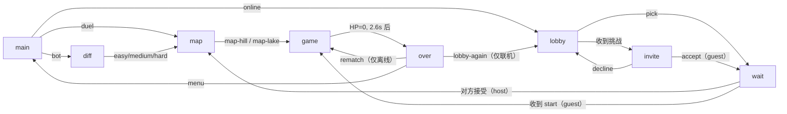

# Cannon Duel — 开发者参考 (Developer Reference)

> 给后续 AI / 开发者的上手文档。目标文件: [cannon_duel.html](cannon_duel.html)（约 2480 行，单文件，无构建步骤、无依赖）。

## 1. 概览

| 项目 | 值 |
| --- | --- |
| 类型 | Canvas 2D 炮战游戏：本地双人 / 人机 / **联机对战** |
| 文件 | `cannon_duel.html`（HTML + CSS + JS 全部内联） |
| 后端 | 统一 Node 游戏服务（[GAME_SERVER.md](GAME_SERVER.md)）里的 [cannon_duel/Server/room.js](cannon_duel/Server/room.js)，**仅联机对战用**，没有排行榜 |
| 依赖 | 无前端依赖。音效用 Web Audio API 实时合成，图形全部 Canvas 绘制 |
| 画布 | `<canvas id="game" width="1500" height="780">`，CSS 宽度 100% 自适应缩放 |
| 入口 | 文件末尾 IIFE：`reset(); showPanel('main'); requestAnimationFrame(loop);` |
| 部署 | 见 §14 → https://oicrusher.me/game/cannon_duel.html |

玩法：两门炮台固定在左右两侧，炮管自动正弦摆动。玩家**按住**按键蓄力，**松开**开火。血量 100，直接命中约 34 伤害（三发命中即胜），垂直下落的"吊射"最高 80 伤害。两颗炮弹空中相撞会产生大范围空爆。

## 2. 修改前必读的关键约束

1. **单文件原则** — 前端不要拆分成 `.js` / `.css`，整站其他游戏（`snake.html`、`tetris.html` 等）都是单文件。
2. **后端只服务联机** — 没有排行榜、不记分数。`cannon_duel_api.php` 只做大厅 + 事件中继；唯一的本地持久化是 `localStorage['cannonDuelSound']` 和两个 cookie（`cannonDuelName`、`cannonDuelSession`）。
3. **坐标系** — 画布坐标 y 轴向下；但角度 / 速度用数学约定（y 向上）。所以发射时 `vy = -sin(angle) * speed`，重力是 `vy += GRAVITY * dt`。改任何弹道代码都要注意这个符号翻转。
4. **地形是函数而非数组** — `terrainY(x)` 实时求值，没有高度数组，地形**不可破坏**（弹坑只是 `decals` 画布上的贴花）。
5. **数值是耦合的** — 见 §5，改一个常数会连锁影响胜负节奏。
6. **联机伤害归射手** — 见 §9。每门炮只结算自己炮弹的伤害，胜负由 host 终裁。改任何伤害 / 碰撞逻辑都必须同时考虑「对方炮弹」分支。

## 3. 文件与代码结构

| 文件 | 作用 |
| --- | --- |
| [cannon_duel.html](cannon_duel.html) | 整个游戏（~3100 行） |
| [cannon_duel_api.php](cannon_duel_api.php) | 联机大厅 + 事件中继 + 战斗记录（POST JSON） |
| [cannon_duel_db.sql](cannon_duel_db.sql) | 5 张表。**不要传到 web 根**，用 `ssh root@oicrusher.me 'mysql -u root games' < cannon_duel_db.sql` |

`cannon_duel.html` 内部按 `// ----------` 分节，顺序如下（用 grep 找节标记，别依赖行号）：

| 分节 | 内容 |
| --- | --- |
| `<head>` | GA4 埋点、SEO meta、全部 CSS |
| `<body>` 标记 | header、`.stage`（canvas + overlay 七个面板）、移动端触控按钮、底部提示条 |
| 常量 | 物理 / 伤害 / 碰撞的全部可调参数 |
| `// ---------- sound` | Web Audio 合成器（IIFE 模块） |
| `// ---------- terrain` | `MAPS`、`groundHeight`、`terrainY`、`isWater`、`randomizeTerrain`、`serializeTerrain` / `applyTerrain` |
| `// ---------- players` | `makePlayers`、`BOTS`、`reset(terrain)`、`updateBot` |
| 开火 | `beginCharge` → `releaseFire` → `fire`（本地意图）→ `launch(shot)`（可重放）、`snapPhase` |
| `// ---------- particles` | `spark` / `ember` / `smoke` / `debris` / `drop`、`splash`、`blast`、`groundBurst` |
| 伤害 | `plungeFactor`、`damageFor`、`damagePlayer`、`blastDamage` |
| `// ---------- mid-air collisions` | `shellApproach`、`checkAirbursts`、`removeShells`、`airburst` / `airburstFx` |
| 结算动画 | `startFinale`、`updateFinale` |
| 主更新 | `stepShell`（固定步长）、`update(dt)` |
| `// ---------- rendering` | `buildScenery`（离屏缓存）、`drawSky`、`drawWater`、`drawCannon`、`drawShells`、`drawParticles`、`drawHud`、`render` |
| `// ---------- loop` | `loop(now)`，`dt` 上限 0.033s |
| `// ---------- input` | 面板路由、`startGame`、`showGameOver`、键盘、指针、音效开关 |
| `// ---------- online duel` | `Net` 模块：cookie、大厅轮询、`enterMatch`、`handle`、`syncTick`、`dropMatch` |

## 4. 核心状态

```js
let players;      // [玩家0=BLUE/左, 玩家1=RED/右]
let shells;       // 飞行中的炮弹（每颗有 sid，联机时用来点名销毁）
let particles;    // 混合粒子池，用 q.type 分派 ('spark'|'ember'|'smoke'|'fire'|'debris'|'drop')
let rings;        // 扩张的冲击波圆环
let columns;      // 水柱
let winner;       // null 或获胜的 player 对象
let banner;       // { text, color, life } —— life===Infinity 表示大号胜利横幅
let mode;         // 'duel' | 'bot' | 'online'
let difficulty;   // 'easy' | 'medium' | 'hard'
let mapId;        // 'hill' | 'lake'
let running;      // false 时 overlay 显示、输入被忽略

// 联机专用
let myIndex;      // 我控制哪门炮：host=0（BLUE），guest=1（RED）
let isHost;       // 发起挑战的一方为 host，持有全部伤害权威
let netNames;     // [左炮名, 右炮名]，reset() 后重新挂到 p.netName
let shellSeq;     // sid 计数器
```

玩家对象字段：`{ id, name, netName, color, rgb, dark, x, y, dir, minA, maxA, phase, angle, hp, flash, shake, recoil, charging, charge }`。

**索引约定**：`players[0]` 永远是左炮（BLUE），`players[1]` 永远是右炮（RED）。bot 模式下人类操作**右炮**；联机模式下 `humanIndex()` 返回 `myIndex`。

## 5. 可调参数与平衡性

```js
const GRAVITY = 480;        // px/s²
const MIN_SPEED = 450;      // 点按最小初速
const MAX_SPEED = 990;      // 满蓄力初速（需足够越过山脊）
const CHARGE_TIME = 1.15;   // 从最小到满蓄力所需秒数
const BARREL_LEN = 74;      // 炮口偏移
const HIT_RADIUS = 34;      // 直接命中判定半径
const SPLASH_RADIUS = 100;  // 落地溅射半径
const MAX_HP = 100;
const SWEEP_SPEED = 1.75;   // 炮管摆动相位速度 rad/s

const DMG_BASE = 12;        // 最差的直接命中
const DMG_DIST = 12;        // 远距离加成
const DMG_ANGLE = 10;       // 入射角加成
// 平地最佳命中 = 34 → 恰好三发直接命中取胜
const DMG_PLUNGE_MAX = 80;  // 满速垂直吊射

const SHELL_COLLIDE = 22;   // 空中炮弹互撞距离
const AIRBURST_RADIUS = 180;
const AIRBURST_MULT = 1.8;
```

**伤害公式**（`damageFor`）：
$$\text{flat} = 12 + 12 \cdot \frac{d}{\text{GUN\_SPAN}} + 10 \cdot \frac{|v_y|}{|v|}$$
$$\text{dmg} = \text{flat} + (80 - \text{flat}) \cdot \text{plunge}$$
其中 `plunge = clamp(steep)^1.5 * clamp(fast)`，`steep` 在 30° 入射时为 0、垂直下落时为 1；`fast` 由初速归一化。

**改动警告**：`DMG_BASE + DMG_DIST + DMG_ANGLE = 34`，刻意设计成 `ceil(100/34) = 3` 发命中结束比赛。改这三个数会直接改变对局长度，HUD 血条上的 1/3、2/3 刻度线（`drawHpBar`）也会对不上。

## 6. 地形系统

两张地图，都左右镜像对称（`profileHeight` 用 `u = t<=0.5 ? t : 1-t`），保证双方面对同样的弹道问题。

- **`hill`（Ridgeline）** — 余弦生成的单座中央山脊，无水。
- **`lake`（Crater Lake）** — 双峰之间夹一个**悬湖**。注意：湖面 `waterHeight` 高于炮台平台，所以 `isWater(x)` 必须同时检查水平范围（`lakeFrom`/`lakeTo`）和 `groundHeight(x) < waterHeight`。

`randomizeTerrain()` 每局重新随机，但有**可玩性校验**：最多尝试 80 次，调用 `reachableAngles()`（在 20°–84° 范围内步进扫描，每个角度再扫描初速）统计有多少摆动角度存在可命中的解，`hill` 要求 ≥8、`lake` 要求 ≥7，否则重新生成。失败则回退到上一次或 `defaultProfile()`。

**如果你要加第三张地图**：在 `MAPS` 加条目 → 在 `randomizeTerrain()` 加分支 → 在 `groundHeight()`/`isWater()` 处理新 `kind` → 在 `#panelMap` 加按钮并在 overlay 的 `switch` 里加 `case`。

## 7. 弹道与碰撞

`stepShell(shell, dt)` 用**固定步长** `SHELL_STEP = 1/360` 积分（每颗炮弹自带 `acc` 累加器），返回 `'fly' | 'hit' | 'ground' | 'water' | 'gone'`。检测顺序：出界 → 命中敌方炮台 → 入水 → 撞地。

> 为什么是固定步长：联机时两端的帧率不同，若用 `dt/6` 划分，相同的初始参数会走出不同的轨迹。固定步长让轨迹成为发射参数的**纯函数**。别改回 `dt/N`。

**空中互撞**（`checkAirbursts`）：炮弹每帧位移很大，点对点检测会穿过彼此，所以用 `shellApproach(a, b)` 求两条帧内线段的**最近接近距离**（相对运动的解析最小值，参数 t 夹在 [0,1]）。每帧最多触发一次爆炸。每帧开头 `update()` 会把 `s.px/s.py` 存为帧起点。

**Bot AI**（`updateBot`）：复用 `closestApproach()` 做前向弹道模拟。Bot 开始蓄力后持续评估当前功率的落点误差，一旦 ≤ `botTol` 就开火；若整条功率爬升都没解就强行倾泻（`botHold > CHARGE_TIME + 0.25`）后重新扫描。难度不是靠改容差，而是靠 `missRate`——按概率故意把初速乘上 `(1 ± botErr)` 打偏，使命中率落在约 15% / 25% / 50%。反应延迟 `botReact()` 带抖动，避免射击节奏锁死在炮管摆动周期上。

## 8. 渲染要点

- **离屏缓存**：`scenery`（远山、地面、岩石、草）只在 `buildScenery()` 时画一次；`decals`（焦痕 `scorch()`）累积绘制，`reset()` 时 `clearDecals()`。主循环只做 `drawImage`。
- **伪随机**：`noise(i)` 是确定性哈希（`sin(i*127.1+311.7)*43758.5453` 取小数），保证星星、草、石头位置在帧间稳定。
- **屏幕震动**：`render()` 开头 `ctx.translate` 随机抖动，幅度 `min(shake, 20)`，`shake` 每帧指数衰减。
- **`winTint`**：胜利后用 `globalCompositeOperation = 'overlay'` 给全屏染上胜者颜色，并从胜者炮台发射旋转光芒。
- **`roundRect` polyfill** 在文件末尾，针对老浏览器。

## 9. 联机对战（Online Duel）

### 9.1 角色与权威

- **发起挑战的一方 = host = BLUE = `players[0]` = 左炮**，`isHost = true`。
- **接受挑战的一方 = guest = RED = `players[1]` = 右炮**。
- host 选地图，guest 等待。

**几条不可违反的规则**：

1. **发射参数归射手**。炮管在摆动，延迟下如果让对手用「收到时的角度」重算，打出来的就不是你瓄的那一炮。所以 `fire()` 把完整的 `{owner, sid, ang, pw, x, y, vx, vy}` 发出去，对面用 `launch(shot)` **原样重放**（并 `snapPhase()` 把对方炮管吸附到该角度，避免炮弹不从管口出）。
2. **伤害归射手（shooter-authoritative）**。两端都本地模拟炮弹的飞行（固定步长 + 相同地形，轨迹一致），每门炮只结算**自己的**炮弹：
   - `damagePlayer()` 里 `!fromNet` 时若 `shell.owner !== myIndex` 直接 return —— 对方炮弹落地在本地只有特效，伤害等对方的 `dmg` 事件；
   - 自己炮弹造成的每次扣血都发一条 `dmg`，对面用 `fromNet=true` 重放。这样射手打中立即扣血，不必再绕一整圈网络（以前 guest 的命中要 guest→服务器→host 重飞→服务器→guest，延迟约两倍轮询）；
   - 对方炮弹在本地落地的时刻 ≈ 对方 `dmg` 事件到达的时刻（两者都晚一个单程延迟），所以画面基本对得上。
3. **空爆两端都检测，谁先看到算谁的**。`checkAirbursts()` 两端都跑，检测到就发 `air`。收到 `air` 时，若这两颗弹本地还有任意一颗在飞，就接受：移除、放 `airburstFx()`，并只结算**自己那颗**弹的空爆伤害（`airburstDamage()` 里跳过 `src.owner !== myIndex`；本地已落地的那颗用 `{gone:true}` 占位跳过）。本地已经两颗都没了 → 已处理过，忽略。每颗弹的伤害只由其主人产生一次，所以两端血量一致。
4. **胜负由 host 终裁**。各自结算会让「几乎同时互相击杀」在两端判出不同胜者。host 判出胜者时发 `win {w, hp}`，guest 用 `settleWinner()` 采纳（校正血量；若胜者不同则复活误判的一方、重放终局，结算面板已出则重绘）。

### 9.2 事件协议

| `t` | 方向 | 负载 | 处理 |
| --- | --- | --- | --- |
| `start` | host → guest | `{terrain: {mapId, TP, waterHeight}}` | guest `startGame(terrain)`，`terrainSeen` 防重 |
| `chg` | 双向 | `{owner}` | 对面显示蓄力光效 |
| `fire` | 双向 | `{owner, sid, ang, pw, x, y, vx, vy}` | `snapPhase()` + `launch()` |
| `dmg` | 双向（射手 → 对面） | `{owner, x, y, g, d, i, dir, l}` | `damagePlayer(..., fromNet=true)`，`g` 是受害者索引 |
| `air` | 双向 | `{a, b, x, y, p}` | 本地还有其中一颗在飞才处理：`removeShells` + `airburstFx` + 只结算自己那颗 |
| `win` | host → guest | `{w, hp}` | `settleWinner()`：host 的胜负与血量为准 |
> 「再来一局」和离开不再是对局事件：分别由大厅消息 `rematch` / `rematch_ask` 和 `leave` / `end` 处理（见 §9.3、§9.3.1）。

### 9.3 传输：WebSocket 中继（2026-10-18 从 PHP 轮询迁移）

- 连接 `wss://oicrusher.me/game/cannon-ws`，Apache 反代到统一 Node 服务的 `/cannon` 路径；本地调试可加 `?ws=ws://127.0.0.1:8090/cannon`。
- 大厅（在线列表、挑战、接受/拒绝、战绩）用通用的 [game_server/Lobby.js](game_server/Lobby.js)，协议与 Photonic Fencing / Element Core 相同：`hello` / `lobby` / `challenge` / `respond` / `cancel` / `leave` / `rematch`。没有 token 和 cookie 会话了，只用 cookie `cannonDuelName` 记住名字。
- 对局内事件（§9.2 那张表里的 `start/chg/fire/dmg/air/win`）包成 `{t:'ev', e:<事件>}` 发给服务器，[room.js](cannon_duel/Server/room.js) **收到就转发**给对手，顺序由 TCP 保证。`start`、`win` 只接受 host 发的。不再有 `since` 游标、50ms 轮询和"每局最多一个请求在途"的约束。
- 游戏规则完全没变：仍然是射手结算伤害、host 终裁胜负，服务器只转发不判定。
- **事件分发**仍然每条单独 try：一条坏事件不能拖垮后面的。
- **断线**：WebSocket 断开或 15s 没回 ping，服务器把对局结束并给对手发 `{t:'end', why:'disconnected'}`；主动离开（Esc / Leave）发 `leave`，对手收到 `why:'left'`。在结算面板上收到 → `rematchOff()` 只收起"再来一局"；对局中收到 → `dropMatch()` 回大厅。
- **改名竞态**：`connect()` 正在建立时只复用同一个 Promise，连上后发送输入框里**当时**的名字，`welcome` 不覆盖正在输入的输入框。否则快速改名会开出第二条连接，留下一个默认名字的"幽灵"玩家。

### 9.3.1 再来一局（rematch）

结算面板上任意一方点 `↻ Play again` 就发 `{t:'rematch'}`；对手收到 `rematch_ask`，显示 "X wants another round."。双方都点过后，服务器直接给这两人开一个**新房间**，两端都收到新的 `match`：host 进选图面板，guest 显示等待。旧的"guest 靠 sync 报 ended 推断开局"握手已经不需要了。

### 9.4 服务端（`cannon_duel/Server/room.js`）

| 消息 | 说明 |
| --- | --- |
| `{t:'ev', e}` | 白名单 `start/chg/fire/dmg/air/win` 原样转发给对手；`start`、`win` 仅 host |
| `{t:'report', winner, map, dur, air, w, l}` | **仅 host、每局一次**：数值全部夹区间，名字取大厅里的名字（不信任客户端），写入战绩 |

单条 WebSocket 消息上限 4KB（`start` 带的地形只有几百字节），每连接约 120 条/秒限流，每 IP 最多 8 个连接。

### 9.5 战斗记录（Battle history）

- 客户端统计和上报时机不变（`showGameOver()` 里 host 调 `Net.reportResult()`，见下方字段表）。
- 服务器把最近 12 场存在 `/opt/oicrusher-games/data/cannon-recent.json`，大厅消息里直接带给每个人（不用再每 5 次轮询取一次）。迁移时把 MySQL `cannon_duel_history` 最新的 12 条转了过来。
- 只记 host 上报的完整对局；中途离开不记。

| 字段 | 在哪里加 |
| --- | --- |
| `shots[owner]` | `launch()` |
| `dmg[shell.owner]` / `hits[...]` | `damagePlayer()`（`direct` 才算 hit） |
| `air` | `airburstFx()` |
| `duration` | `startFinale()` 里快照 `elapsed` |

> `dmg` 是**毛伤害**（最后一击的溢出会算进去），所以可能超过 100。`dur` 是**游戏内时间**（`elapsed` 累加，dt 上限 0.033），掉帧时会比墙上时间短。

### 9.6 已知局限

- 浏览器会冻结后台标签页的 `requestAnimationFrame`，切走的一方画面会停住（事件照常收，回来后集中处理）。自测请用两个独立窗口。
- 每帧 dt 上限 0.033s，所以帧率很低时（例如无头浏览器同时跑两页只有 ~6fps）游戏时间会变慢，结算面板要等更久才出现，这不是 bug。

### 9.7 旧 PHP 版本

`cannon_duel_api.php` / `cannon_duel_db.sql` 只作为历史参考保留在仓库里，**已从网站目录删除**，不要再部署。MySQL 里的 `cannon_duel_*` 表没有删（数据仍在），迁移前的完整备份在服务器 `/root/game-backups/20261018-144524/`（含 `cannon_duel_tables.sql` 和旧的 html/php）。

## 10. 输入

| 输入 | 行为 |
| --- | --- |
| `W`（按住/松开） | duel：左炮。bot / online：我的炮 |
| `↑`（按住/松开） | duel：右炮。bot / online：我的炮 |
| `Space` | bot / online 有效；duel 模式被 `preventDefault` 吞掉以免误触 |
| `R` | 重开当前对局（online 模式禁用） |
| `Esc` | 回主菜单；online 模式下回大厅 |
| 触控按钮 | `#btnP1` / `#btnP2`，用 pointer 事件 + `setPointerCapture` |

`held` 对象过滤键盘自动重复。`window blur` 时自动释放所有按住的键（否则切窗口会卡在蓄力状态）。

`typing()` 守卫：焦点在 `<input>` 里时整个键盘处理器直接 return，否则在大厅输名字打 `W` 会触发蓄力并被 `preventDefault` 吞掉字符。

`gunFor(code)` 决定按键映射到哪门炮——只有 duel 模式区分 W/↑，其他模式三个键都映射到 `humanIndex()`。

## 11. 菜单流程



所有面板点击走 overlay 上的**单个事件委托**，靠 `data-act` 属性分派（`cannon_duel.html` 末尾的 `switch (act)`）。加新按钮只需加 `data-act` + 一个 `case`。玩家列表的挑战按钮用 `data-act="pick"` + `data-id`。

> 注意：`.panel button` 有 `display: block`，会盖掉 `hidden` 属性的 UA 样式，所以额外加了 `.panel button[hidden] { display: none; }`。

## 12. 音频

`Sound` 是一个 IIFE 模块，**全部音效实时合成**，没有音频文件。内部工具：`noise()`（扫频滤波白噪声）、`tone()`（扫频振荡器）、`metal()`（三个非谐波三角波叠加）。

公开 API：`unlock()`、`toggle()`、`enabled`、`fire(p)`、`ground(p)`、`water(p, steep)`、`directHit(k)`、`graze(k)`、`chain()`、`airburst(k)`、`victory(rising)`、`startCharge/setCharge/stopCharge(id)`、`whistle/whistleUpdate/whistleStop(handle)`。

- AudioContext 必须由用户手势解锁 —— 每个 `keydown` / `click` / `pointerdown` 都调用 `Sound.unlock()`。
- **蓄力音**和**呼啸音**是持续节点，必须成对关闭。`reset()` 里显式调用 `stopCharge(0)` / `stopCharge(1)` 并遍历 `shells` 调 `whistleStop`，否则会泄漏振荡器。新增提前销毁炮弹的逻辑时记得同样处理。

## 13. 常见任务速查

| 想做的事 | 改哪里 |
| --- | --- |
| 调整对局长度 | `DMG_BASE` / `DMG_DIST` / `DMG_ANGLE`（注意三发命中的设计）+ `drawHpBar` 刻度线 |
| 让炮管摆得更快/更慢 | `SWEEP_SPEED`；角度范围在 `makePlayers()` 的 `minA`/`maxA` |
| 增减蓄力时间 | `CHARGE_TIME`，可能需同步调 `MIN_SPEED`/`MAX_SPEED` 保证能越过山脊 |
| 加新难度 | `BOTS` 加条目 + `#panelDiff` 加按钮 + overlay `switch` 加 `case` |
| 加新地图 | 见 §6 末尾四步 |
| 加新粒子类型 | 加工厂函数 + `update()` 的 `switch (q.type)` 分支 + `drawParticles()` 分支 |
| 加新联机事件 | `Net.send({t:'xxx', ...})` + `handle()` 加 `case`；想清楚谁是权威方 |
| 改联机轮询频率 | `Net` 里的 `LOBBY_MS` / `SYNC_MS`（50ms 是刻意调低的，换延迟用服务器负载） |
| 关闭/更换 GA 埋点 | 文件开头 `G-L8GMZRR0GY` |
| 加排行榜 | 需新建 PHP API，参考 `tetris_api.php` 的模式 |

## 14. 部署

```bash
cd zhengxi-liu-site/game
scp cannon_duel.html root@oicrusher.me:/var/www/html/game/
# 只有改了服务端（cannon_duel/Server/room.js）时：
scp cannon_duel/Server/room.js root@oicrusher.me:/opt/oicrusher-games/cannon_duel/Server/
ssh root@oicrusher.me 'curl -s 127.0.0.1:8090/health && systemctl restart oicrusher-games'   # 先看有没有人在打
```

统一服务的运维、日志、更新流程见 [GAME_SERVER.md](GAME_SERVER.md)。

## 15. 测试

没有自动化测试。手动验证清单：

**离线**
1. 三种模式 × 三个难度 × 两张地图都能开局，地形不会生成成死局。
2. 蓄力音在开火时停止；切换浏览器标签页（blur）后不残留蓄力音。
3. 两人同时满蓄力对射可触发 `MID-AIR COLLISION!` 横幅。
4. `lake` 地图上落水产生水柱且水花不越过湖岸（`clip` 边界）。
5. 胜利动画约 2.6 秒后弹出结算面板；`Rematch` 与 `Main menu` 均可用。
6. 窄屏（<760px）下触控按钮出现且可用。
7. 刷新后音效开关状态保持（localStorage）。

**联机**（用**两个独立浏览器窗口**，别用同一窗口的两个标签页）
8. 首次进入自动生成 `GunnerNNN`；改名后刷新页面名字还在（cookie `cannonDuelName`）；连接中快速改名不会出现第二个玩家。
9. A 挑战 B：B 弹出 Accept/Decline；Decline 后 A 看到 "B declined." 并回大厅。
10. 接受后 host 选地图，guest 显示 "… is choosing the battlefield…"，开局后两边地形完全一致。
11. 一方开火，另一方能看到同样轨迹的炮弹从炮口飞出。
12. 命中后两边血条同步掉血、同一条伤害横幅。
13. 空中相撞时两边都播空爆。
14. 一方按 Esc 回大厅，另一方收到 "Your opponent left the match."。
15. 直接关掉一方的标签页，另一方立刻（最迟 15 秒心跳超时）被送回大厅。

**战斗记录**
16. 对局结束后回大厅，"Recent battles" 第一条就是刚打完的那局，比分 / 地图 / 时长 / 命中数都对。
17. 另一个没参战的浏览器打开大厅，也能看到这条记录。
18. 窗口很短时（或手机端）大厅面板内部滚动，不会溢出画布。

查数据库：
```bash
ssh root@oicrusher.me 'mysql -u root -e "USE games; SELECT * FROM cannon_duel_history ORDER BY id DESC LIMIT 5\G"'
```

本地联调：在 `game_server/` 里 `node server.js`，在 `game/` 里 `python3 -m http.server 8765`，然后打开
`http://127.0.0.1:8765/cannon_duel.html?ws=ws://127.0.0.1:8090/cannon`。
